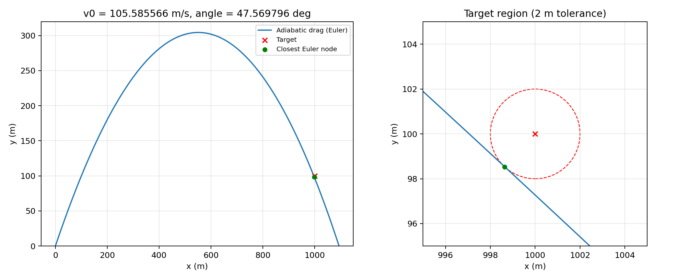

# 作业五：含二次空气阻力的最佳发射参数

## 运行

```bash
python -m pip install -r hw05/requirements.txt
python hw05/projectile.py
python -m unittest discover -s hw05 -v
```

所有输出保存在脚本所在的 `hw05` 目录，与运行时的工作目录无关。

- `projectile.py`：继承实现、欧拉积分、参数优化、绘图。
- `results.json`：完整精度的数值结果。
- `trajectory.csv`：完整轨迹，列为时间、位置和速度（SI 单位）。
- `trajectory.png`：轨迹与目标附近放大图。
- `test_projectile.py`：模型、积分方法及命中结果的自动测试。
- `assignment.txt`：原题 PDF 的文字提取，原 PDF 保持不变。

## 1. 模型及程序结构

```text
Projectile
└── AdiabaticDragProjectile
    └── ConstantDensityProjectile（仅用于对照分析）
```

基类 `Projectile` 保存质量、重力加速度和时间步长，并且只在其 `simulate` 方法中编写欧拉迭代。基类的加速度为无阻力情况下的 `(0, -g)`。子类 `AdiabaticDragProjectile` 重写 `acceleration` 方法，主程序和优化器均调用继承的积分方法，不重复实现迭代。

按照题目取

\[
m=10\,\mathrm{kg},\quad g=9.8\,\mathrm{m/s^2},\quad
B_2/m=4.0\times10^{-5}\,\mathrm{m^{-1}},\quad\Delta t=0.01\,\mathrm{s}.
\]

密度比及加速度为

\[
f(y)=\frac{\rho(y)}{\rho_0}=\left[\max\left(1-\frac{ay}{T_0},0\right)\right]^{\alpha},
\quad a=0.0065,\ T_0=300,\ \alpha=2.5,
\]

\[
a_x=-\frac{B_2}{m}f(y)\sqrt{v_x^2+v_y^2}\,v_x,\qquad
a_y=-g-\frac{B_2}{m}f(y)\sqrt{v_x^2+v_y^2}\,v_y.
\]

当高度达到或超过约 46153.85 m 时，密度为零。程序提供 `density` 方法；其默认海平面密度仅用于给出绝对密度，不影响动力学，因为阻力仅依赖密度比。

每一步的位置和速度更新均使用**旧时刻**的状态，严格采用显式欧拉法，而不是先更新速度再更新位置的半隐式方法。完整轨迹积分到首次低于地面，最后一个负高度节点仅用于标记落地越界。

## 2. 搜索及命中定义

在 `100 ≤ v0 ≤ 1000 m/s`、`10° ≤ θ ≤ 80°` 的边界内，最小化初速度。对给定参数，计算全部相关欧拉节点到 `(1000,100)` 的距离，并以最小距离作为约束。命中判定不对节点之间的线段插值。

搜索使用 SciPy 的 SLSQP 约束优化，在整个角度范围每隔 5° 设置一个初值；初速度初值由无阻力的解析公式估计。随后针对最优解附近的 11 个离散时刻分别固定节点再次优化，以减少最近节点切换导致的局部数值问题。最后重新计算完整轨迹，检查确实存在距离小于 2 m 的节点。速度在 `1e-8 m/s` 数值精度内相同时选择较小角度。这是多初值数值搜索，不是全局最优性的严格数学证明。

**严格不等式的说明：**题目规定距离 `< 2 m`。在这个开区域上，速度通常只有下确界，边界上的极限方案并不命中。因此程序使用 `距离 ≤ 1.999 m` 的约束，在边界内保留 1 mm 裕量，报告数值意义上的近似最小初速度。不要把结果理解为严格开集上已取得的数学最小值，也不要将“进入目标附近”与“精确经过目标中心”混为一谈；精确经过中心所需的速度更高。

## 3. 计算结果

| 输出量 | 结果 |
|---|---:|
| 最佳发射角度 | **47.569796°** |
| 近似最小初速度 | **105.585566 m/s** |
| 飞行时间（发射至首次命中） | **14.35 s** |
| 最高高度 | **304.348601 m** |
| 最近节点与目标的距离 | 1.999000 m |
| 最近节点位置 | (998.642306, 98.532803) m |
| 首次低于地面的欧拉节点时刻 | 15.77 s |

题目中的“飞行时间”按发射至命中理解；若让炮弹继续飞行到地面，15.77 s 是第一次地下节点的时间，而不是插值得到的精确落地时刻。最高点发生在命中之前，因此完整轨迹与命中前轨迹的最高高度相同。



## 4. 密度变化的影响

在约 304.35 m 的最高点，密度比为 **0.983596**，即比地面低约 **1.64%**。由于阻力加速度正比于密度，同样的速度在高处受到的阻力更小。与始终使用海平面密度相比，高空阶段的水平速度损失减小，总体上更容易到达远处目标。竖直方向上，阻力始终与竖直运动方向相反，因而不能简单地说降低密度在上升和下降阶段都增大向上的加速度。

使用相同的欧拉步长、搜索范围与 1.999 m 命中约束，得到以下对照：

| 模型 | 近似最小初速度 (m/s) | 对应角度 (°) |
|---|---:|---:|
| 无空气阻力 | 103.885959 | 47.796256 |
| 绝热变密度阻力 | 105.585566 | 47.569796 |
| 恒定海平面密度阻力 | 105.601004 | 47.528731 |

变密度模型相对于恒密度模型降低所需初速度约 **0.01544 m/s（0.0146%）**。本题高度较低，密度变化有限，所以这个修正较小；但空气阻力本身仍明显提高了所需初速度。

以上均是规定 `Δt=0.01 s` 下的离散结果。欧拉法具有一阶全局误差，且命中只检查离散节点；所列小数用于复现计算，不代表连续物理模型具有相同位数的精度。
