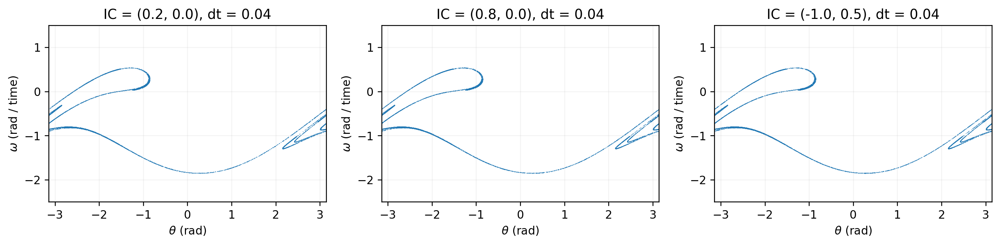
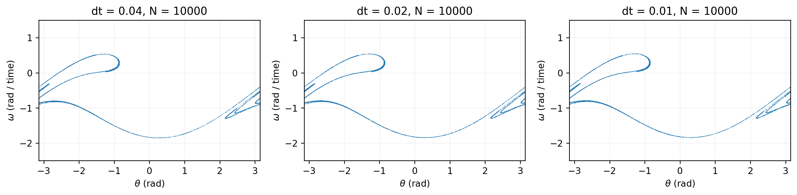
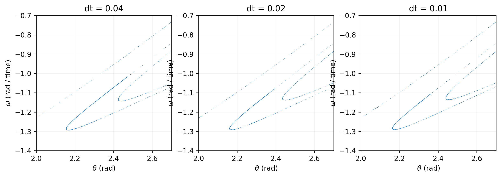
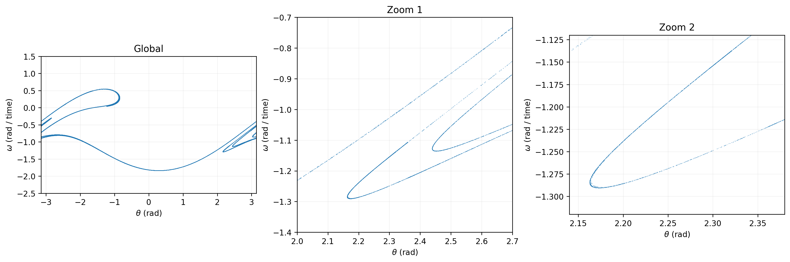
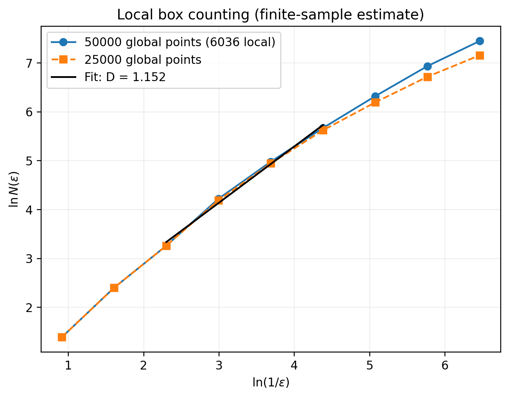

# 受迫阻尼非线性物理摆的奇异吸引子与分形结构

## 1. 模型与数值方法

研究方程

\[
\dot\theta=\omega,\qquad
\dot\omega=-\frac{g}{\ell}\sin\theta-q\omega+F_D\sin(\Omega_Dt),
\]

取 $g=\ell=9.8$、$q=0.5$、$F_D=1.2$、$\Omega_D=2/3$，因此 $g/\ell=1$，驱动周期 $T_D=3\pi\approx9.42477796$。驱动相位在初始时刻为零。

严格采用题目要求的 Euler–Cromer 方法：

\[
\omega_{i+1}=\omega_i+[-\sin\theta_i-0.5\omega_i+1.2\sin(2t_i/3)]\Delta t,
\qquad
\widetilde\theta_{i+1}=\theta_i+\omega_{i+1}\Delta t.
\]

每步先更新角速度，再用**新角速度**更新角度。角度约化为

\[
\theta_{i+1}=((\widetilde\theta_{i+1}+\pi)\bmod 2\pi)-\pi.
\]

该公式得到 $[-\pi,\pi)$ 中的代表元，与题目按 $2\pi$ 加减的做法物理等价。两端对应同一物理角度；绘图中边界附近的断开不能解释为吸引子的物理断裂。

### 固定相位采样

$T_D/\Delta t$ 不是整数，不能每隔四舍五入后的固定步数采样，否则驱动相位会逐渐漂移。这里保持积分步长严格不变，令 $t_i=i\Delta t$，在跨越目标时刻 $t_n=nT_D$ 的一步中，取

\[
\alpha=\frac{t_n-t_i}{\Delta t},\quad
\omega(t_n)\approx(1-\alpha)\omega_i+\alpha\omega_{i+1},\quad
\theta(t_n)\approx\operatorname{wrap}\{\theta_i+\alpha(\widetilde\theta_{i+1}-\theta_i)\}.
\]

角度先用**尚未约化的步末值**插值，再约化，避免跨越 $\pm\pi$ 时错误地穿过零点。插值不改变 Euler–Cromer 全局一阶精度；其作用是消除采样相位漂移，而不是消除积分误差。

## 2. 实验设置

所有实验舍弃前 $300T_D=2827.433388$ 的暂态，从 $301T_D$ 开始每周期采样一次。

| 数据文件 | 初始条件 $(\theta_0,\omega_0)$ | $\Delta t$ | 保留点数 | 最后采样时刻 |
|---|---|---:|---:|---:|
| ic0.csv | (0.2, 0) | 0.04 | 10000 | $10300T_D=97075.212996$ |
| ic1.csv | (0.8, 0) | 0.04 | 10000 | $10300T_D=97075.212996$ |
| ic2.csv | (−1.0, 0.5) | 0.04 | 10000 | $10300T_D=97075.212996$ |
| dt02.csv | (0.2, 0) | 0.02 | 10000 | $10300T_D=97075.212996$ |
| dt01.csv | (0.2, 0) | 0.01 | 50000 | $50300T_D=474066.331427$ |

为了包围最后一次插值采样，实际积分到不早于该时刻的首个网格点：前三组为 97075.24，第四组为 97075.22，最后一组为 474066.34。步长对比图统一使用每组前 10000 个采样点，以免把采样数量不同误认为步长效应。局部放大与盒计数使用最细步长的全部 50000 点。

## 3. 不同初值的庞加莱截面

三组初值的长期点集具有相同的总体轮廓：左上方的回折分支、下方的大弧形分支以及右侧的多条折返细丝均可对应。各次轨道访问这些位置的时刻及散点密度不完全相同，但没有观察到三组初值分别落入不同的长期几何结构。

这些点既不是有限个孤立点，也不能用一条简单光滑闭合曲线描述。全局图中的“曲线”在局部表现为有宽度的细丝和折叠层次。结果支持三组初值位于同一个吸引子的吸引域内；这不等于证明所有可能初值都属于同一吸引域。

阻尼导致相空间收缩。在固定驱动相位下，连续系统线性化流的面积收缩率由散度 $-q$ 给出，一周期面积因子为 $e^{-qT_D}\approx0.0090$。驱动持续输入能量，非线性运动同时产生伸展和折叠，从而可以形成高度压缩但结构复杂的长期不变集合。其吸引性与非光滑、分层几何结构共同支持“奇异吸引子”的解释。不过，本实验未计算 Lyapunov 指数，因此不把散点图单独视为混沌的严格证明。

## 4. 时间步长可靠性检验

在 $\Delta t=0.04,0.02,0.01$ 下，总体轮廓和主要回折分支保持一致，局部多分支形态也没有消失。但是分支位置与折返点存在可见偏移，特别是右侧折返区域。因此，当前结果支持**总体几何结构的定性可靠性**，不能宣称最细层级的位置或维数已经严格收敛。

Euler–Cromer 是一阶方法，缩小步长通常能减小有限时间离散误差；但混沌轨道会放大初始误差和舍入误差，长期逐点比较两个步长的轨道没有必要保持一致。这里应比较吸引子的形状、分支和统计性质，而不是要求第 $n$ 个采样点互相重合。尤其不能把图像相似直接当成轨道误差已被定量控制。

若减半步长后总体形状显著改变，可能是原步长太大、数值映射产生伪结构、暂态尚未充分消失、采样相位不一致，或者有限采样尚未覆盖稀疏分支。需要继续减小步长、延长积分并核查采样算法，而不能直接给出稳定的物理结论。

## 5. 两级局部放大与分形特征

选取 $\Delta t=0.01$ 的 50000 个点，放大范围如下。各图横纵轴均标明物理量，采用相等数值单位的轴比例。

| 层级 | $\theta$ 范围（rad） | $\omega$ 范围 | 窗口内点数 |
|---|---|---|---:|
| 一级放大 | (2.00, 2.70) | (−1.40, −0.70) | 6036 |
| 二级放大 | (2.14, 2.38) | (−1.32, −1.12) | 2939 |

一级区域位于题目建议窗口内部，去掉了大块无点区域。一级图能区分斜向分支、两组折返结构及分支之间的空隙；二级图聚焦其中一个折返尖端，仍能看到弯曲细丝及尖端附近的细小展宽，而不是一个均匀填充的二维区域。当前二级放大的细层间距接近图像分辨率，不能声称已经清楚解析无限层级分裂。

步长减半后主要分支仍然存在，加上增加采样后这些分支可以更充分地被描绘，说明大尺度折叠和间隙不太可能全部由缺点或绘图分辨率造成。但单条细丝内部的最小空隙可能受到采样不足、标记尺寸和数值误差影响，不能把每个小白点都解释成分形孔洞。

综合不同步长的结构一致性、放大后仍存在的细丝与折返，以及下面的非整数有效盒计数斜率，可将结果视为分形特征的数值证据，而不是无限小尺度自相似性的数学证明。分形也不要求各级图案完全相同。

## 6. 选做：局部盒计数维数

在一级窗口内使用边长为 $\epsilon$ 的正方形网格，固定原点为窗口左下角 $(2.0,-1.4)$，用

\[
(i,j)=\left\lfloor\frac{(\theta,\omega)-(2.0,-1.4)}{\epsilon}\right\rfloor
\]

确定格子编号，统计不同编号的数量 $N(\epsilon)$。坐标按图示数值直接计数，不分别归一化两轴；边缘相交网格只要含点也计入。

| $\epsilon$ | $N(\epsilon)$：50000 个全局点 | $N(\epsilon)$：前 25000 个全局点 |
|---:|---:|---:|
| 0.4 | 4 | 4 |
| 0.2 | 11 | 11 |
| 0.1 | 26 | 26 |
| 0.05 | 68 | 66 |
| 0.025 | 145 | 140 |
| 0.0125 | 289 | 276 |
| 0.00625 | 554 | 488 |
| 0.003125 | 1025 | 825 |
| 0.0015625 | 1713 | 1278 |

对中间四个尺度 $\epsilon=0.1,0.05,0.025,0.0125$ 拟合

\[
\ln N(\epsilon)=D_B\ln(1/\epsilon)+b,
\]

得到

\[
\boxed{D_B^{\mathrm{eff}}\approx1.152},\qquad R^2\approx0.99395.
\]

选中间区间是为了避开粗网格只有少量格子时的窗口几何效应，以及细网格下越来越明显的有限采样效应。只用前 25000 个全局点，同一区间得到约 **1.131**。两者接近但不相同，说明样本数影响尚未完全消失。

这个大于 1、小于 2 的**有效斜率**与“比光滑曲线更复杂、但并不填满平面”的结构相容。它不是高精度的理论维数：拟合区间只有四个尺度，相邻尺度的局部斜率并不恒定；网格平移、窗口选择、步长和样本数均会影响结果。高 $R^2$ 也不能替代对尺度区间稳定性的检验。本次未在全部步长下重复高样本盒计数，故不能宣称维数已随步长收敛。

严格说，任何有限离散点集在 $\epsilon\to0$ 时都有 $N(\epsilon)\le6036$，最终计数饱和，其数学盒维数为零。本题估计的是有限但适当尺度范围内底层吸引子的标度趋势，而不是有限 CSV 点集的极限维数。

## 7. 结论与复现

1. 三组初值在舍弃 300 周期暂态后呈现相同的长期细丝状几何结构，支持共同吸引子的解释。
2. 步长从 0.04 减小到 0.01 后，总体轮廓稳定，但局部位置仍有偏移；定性结论比最细尺度的定量结果更可靠。
3. 两级放大显示折返、细丝和间隙，盒计数中间尺度有效维数约 1.15，构成奇异吸引子及分形特征的数值证据。
4. 更严格验证应进一步减小步长、增加样本、检验拟合区间与网格平移的稳定性，并可补充最大 Lyapunov 指数计算。

运行命令和全部文件说明见 [README.md](README.md)。程序保存了原始庞加莱点、盒计数表、参数 JSON 以及 PNG/PDF 图像，可独立复核与重新生成。
